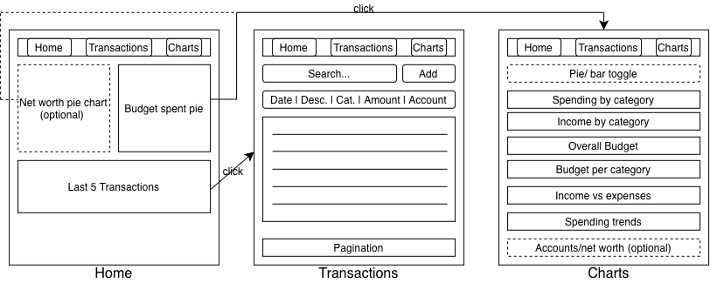
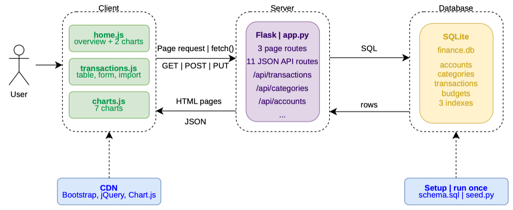
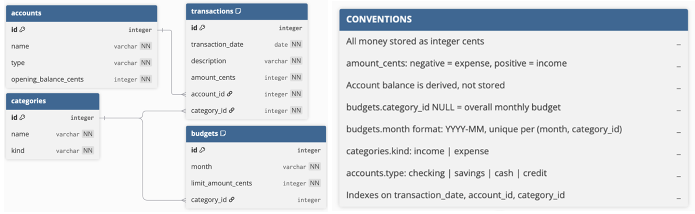
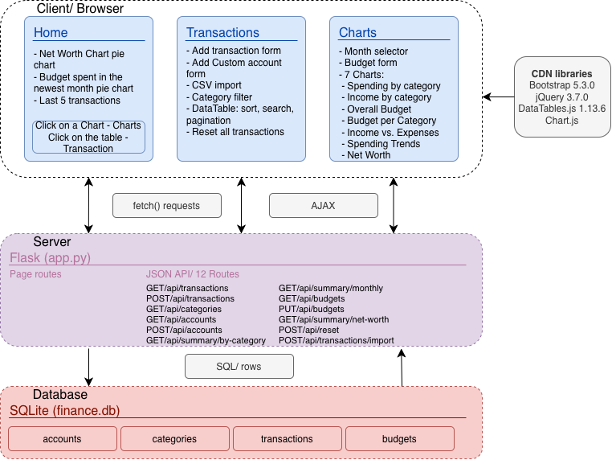

# finance-analytics-dashboard
A web application that helps users understand their personal finances through an interactive transaction table and summary visualizations (spending by category, income vs. expenses, and budget tracking).

Built with Flask, SQLite, Bootstrap, DataTables.js and Chart.js as a portfolio project for the IU course Getting started in Web Programming (DLBITPEWP01_E).

## AI Disclaimer
Artificial intelligence tools were used in the development of this portfolio. Claude (Anthropic PBC) was used to weigh different alternatives, explore possible solutions, and suggest approaches to problems. Furthermore, it was used to assist with debugging, and it was also used to get explana-tions of how different things work. Additionally, it was used to propose some synonyms in the written artefacts and for checking typos and grammar errors. Google's AI-assisted search feature in the browser (not Gemini, Google LLC) was also used to answer questions about how certain things work in programming languages and how to implement certain features (exploring alternatives). The required changes from the Phase 2 feedback regarding AI usage were implemented. The author made all design decisions, and the author wrote and checked the code and the other submitted documents and takes full responsibility for them.

## Scope
Core Minimum Viable Product (MVP)
- Transaction table with sorting, search, filtering and pagination
- Manual entry form and CSV import
- Spending by category, income vs. expenses charts
- Overall monthly budget and per-category budgets
- Spending trends over time

Optional (if time is available)
- Comparison of income and expenses across different accounts (Update: dropped, not implemented)
- Net worth chart (Update: implemented)
- Pie/ bar toggle for the chart (Update: dropped, not implemented)

Added during development:
- Reset button to delete all transaction with confirmation
- Form to create custom accounts
- Success and error message above the forms

## Diagrams
Wireframe diagram:
The final app differs slightly from the planned wireframe in phase 1. Whereas the three dashboard tabs are presented as intended, the optional pie/bar toggle was dropped, so spending and income by category are shown as pie charts only. A CSV import field, an account form, a month selector, a budget form and a reset button were added. Additionally, the search, filter and add function look different than on the wireframe.



System architecture diagram (updated in Phase 2):
Since then, one JSON API route was added (POST /api/accounts), so the server now has 12 instead of 11 API routes. DataTables is also loaded from the CDN with Bootstrap, jQuery and Chart.js. The System architecture diagram was kept as handed in phase 2.



Entity relationship diagram and data conventions of the database (unchanged since Phase 1).



## Data model
Tables: accounts, categories, transactions, budgets

Conventions:
- All monetary values are stored as integer cents.
- transactions.amount_cents: negative = expense, positive = income. The sign is set automatically by the server, depending on the type of the category.
- Account balances are not stored. They are derived as opening_balance_cents + SUM(transactions.amount_cents).
- budgets.category_id is nullable. NULL denotes the overall monthly budget and a value denotes a per-category budget.
- budgets.month uses the format YYYY-MM and is unique per (month, category_id).
- categories.kind: income or expense.
- accounts.type: checking, savings, cash or credit.
- Foreign keys are enforced (PRAGMA foreign_keys = ON on every connection).

## API routes
```
GET, POST  /api/transactions                        Lists or creates transactions.
POST       /api/transactions/import                 CSV text, creates multiple transactions (all or nothing).
GET        /api/categories                          All categories with id, name and kind.
GET, POST  /api/accounts                            List accounts with derived current balance or creates a new account.
GET, PUT   /api/budgets?month=YYYY-MM               Reads or sets budgets for the given month.
GET        /api/summary/by-category?month=YYYY-MM   Spending and income totals per category.
GET        /api/summary/monthly                     Income vs. expenses per month.
GET        /api/summary/net-worth                   Balance per account (optional feature).
POST       /api/reset                               Reset transactions (additional added feature during the build process).
```

All amounts are returned as integer cents. Invalid input is answered with a JSON error message.

## CSV import format
The CSV text is pasted into the text field on the Transactions page (no file upload).

Expected columns: date, description, amount, category, account
- A header line (date, description, amount, category, account) is optional.
- date: YYYY-MM-DD
- description: not empty, at most 100 characters, no commas
- amount: decimal with a point, without a minus sign, for example: 10.49. The category decides if it is an income or an expense. The amount cannot be 0.
- category and account: must match existing entries by name

Every line is checked first. If one line is wrong, nothing is imported and an error message with the line number will be shown.

Example:
```
date,description,amount,category,account
2026-10-25,Billa,23.41,Groceries & Household,Giro
2026-10-26,Bonus,15000,Other Earnings,Giro
```

## Setup
Requirements: Python 3.9 or newer and an internet connection (Bootstrap, jQuery, DataTables.js and Chart.js are loaded from CDNs). No environment variables are needed.


1. Clone the repository:
```
git clone https://github.com/selvasebastian/finance-analytics-dashboard
cd finance-analytics-dashboard
```

2. Create and activate a virtual environment:
```
python3 -m venv venv
```
mac:
```
source venv/bin/activate
```
Windows:
```
venv\Scripts\activate
```

3. Install dependencies:
```
pip install -r requirements.txt
```

4. Create the database with sample data/ this also resets the database
```
python3 seed.py
```

5. Start the server:
```
python3 app.py
```

6. Open the app in a browser:
```
http://127.0.0.1:5000
```
The server is stopped with Control + C (on Mac). On macOS, the port 5000 can be blocked by Airplay. It can be turned off in System Settings/General/Airdrop & Continuity.

## Sample data
seed.py creates the tables from schema.sql and inserts:
- 4 accounts: Giro, Savings, Cash and Credit Card (Balance 0 for the Credit Card)
- 8 categories (2 income, 6 expense)
- 34 transactions from June to October 2026
- An overall budget and a budget for every expense category for each month

## Dependencies/ Tech stack
Backend
- Flask 3.1.3
- Python 3
- JSON API, 12 routes
- SQLite (built into Python, no installation needed)

Frontend
- Bootstrap 5.3.0
- jQuery 3.7.0
- DataTables.js 1.13.6
- Chart.js (newest version from the CDN)
- CSS
- HTML
- JavaScript

Tools
- Git and GitHub
- Microsoft Visual Studio Code
- Google Search aid AI in the browser (see AI Disclaimer, Google LLC)
- ClaudeAI (Anthropic) (see AI Disclaimer, Anthropic PBC)
- draw.io, dbdiagram.io and Canva for the diagrams

## Manual/ Important Notes
- The system will come with predefined data. "Reset all transactions" on the transactions page deletes all transactions after a confirmation, so users can start entering their own data. The accounts and their opeing balances are kept. Running "python3 seed.py" restores the sample data.
- New accounts can be created with the "Add New Account" form on the Transactions page (types: checking, savings, cash, credit).
- Amounts are always entered without a minus sign. Whether a transaction is an expense or income is decided by its category.
- All  fields on the Transactions page for adding new data must obtain inputs. The input is checked by the browser and the server. If something is wrong, an error message is shown and nothing is saved.
- Budgets are set on the Charts page for the selected month. A category only appears in the "Budget per Category" chart once it has a budget for that month.
- The application requires an active internet connection to function, although the backend runs locally. This is because of the usage of Bootstrap, jQuery, DataTables.js and Chart.js.
- The CSV import is a text field where CSV text is pasted, not a real file upload.

## Known limitations
- Pie charts cannot show negative values. An account with a negative balance is drawn in the net worth chart as if it were a positive amount. The software also does not check if an account has enough money (for example cash can go below 0). For this reason, the credit card in the sample data has a balance of 0.
- The income categories "Salary" and "Other Earnings" are recognized by their names in charts.js. A potential new category would also have to be added there.
- Single transactions cannot be edited or delted.
- A future version of Chart.js could change how the charts look.

## Potential further improvements
- More account types, for example overdraft account, mortgage account, car loan account (currently only checking, savings, cash and credit).
- Deletion and editing of single transactions, because currently there is no possibility to edit a transaction if some data was entered falsely.
- Showing customized time horizons of the charts, because now it is only possible to show one month at a time. Also filtering what categories should be shown in a pie or bar chart is currently not possible, for example showing only basic need categories in the spending by category pie chart.
- Adding further categories and also sub categories. Transport for instance could be split into car and everything that goes alongside it (insurance, fuel, service, repair, etc.) and transport including everything else. Health could be split into Sport and "real health expenses" like pharmacy or doctor.
- Different default/accounting currencies to scale the system to other regions.
- Spending from a savings account isn't really the purpose of this account type. Therefore, it would be sensible to limit the possible transactions of savings account to transferring money from and to the giro account.
- Checking the account balance before saving an expense, so that, for example, cash cannot go below 0. Showing negative balance (e.g. credit cards, overdraft) correctly in the charts.
- Bank/Broker/Crypto Wallet and Exchange API integration for automatic transaction and asset live price import so users can track their net worth.
- Allowing users to add other assets like gold or so with their purchasing price and track the unrealized profit.
- Offering tax statements (only information - no real tax reports, due to liability reasons) that show into which number in the tax statement the user has to write which amount. This can be scaled to different countries. Possibility also working together with tax advisors and earn a referral for passing them some clients.
- Machine learning of user spending behavior and learning what the user pays twice, for instance they have a car insurance and are a member of an ÖAMTC special insurance that covers basically the same.
- Working together with insurances and financial institutions by using affiliate links for promoting products that customers don't have according to their spending habits. 
- Add user login/account. Letting several people have access to a certain views/transactions so accounts that are owned jointly by several people can be managed by all owners.
- A real CSV file upload instead of the text field and an export as CSV or PDF 
- An option to also reset the opening balances of the accounts, because "Reset all transactions" only deletes the transactions.
- Splitting app.py into several modules and automated tests it the project grows any further.
- The possibilty that expense categories could also receive income (for instance when an user gets a payment of an insurance).

## Changes since Phase 2 (Change Tracking)
Tutor feedback implemented:
- Month selector inseat of the hardcoded month
- AJAX instead of page reloads
- Automatic minus sign for expenses
- Server-side CSV validation and of other forms
- requirements.txt added, .DS_Store removed
- JOINs instead of old SQL
- Diagrams added to the Github repo

Other Changes
- Custom accounts, cash and credit card accounts added
- Confirmation before "Reset all transactions"
- Debug mode turned off
- ...

## Note on the submission
The Phase 1, 2 documents were submitted once as original and once as updated Version according to the feedback. For Phase 3 I assumed that the 2 page limit only includes text and not pictures. The diagram of Phase 3 is also available on GitHub:



